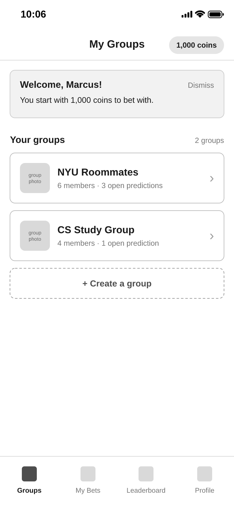

# Bet on Your Friends UX Design

**Bet on Your Friends** is a web app where friends make predictions about each other's lives and bet virtual coins on the outcomes.

## Wireframes

[Here](https://www.figma.com/design/swvxz89hm5fBcoFZp1cMPC/bet-on-your-friends?node-id=6-283&t=JWvmNmBGUGidtrnL-1) is the link to our wireframes.

Editable SVG files and PNG exports for the added screens are in [ux-design](ux-design/).

## Prototype

[Clickable prototype](https://www.figma.com/proto/swvxz89hm5fBcoFZp1cMPC/bet-on-your-friends?node-id=65-2&scaling=min-zoom&content-scaling=fixed&page-id=0%3A1&starting-point-node-id=65%3A2). Anyone with the link can view it. Flow 1 starts at Login; Flow 2 starts with a group invitation.

## App Map

## Work Split

- **Sufyan Waryah** ([sufyanw](https://github.com/sufyanw))
- **Alisha Zaman** ([az2924](https://github.com/az2924)): Created wireframes for My Groups, Group: Resolved Predictions, Prediction Detail (Bettor View, Not Enough Coins, Already Bet, Creator View), Create Prediction (and Errors), and Profile; Created the app map for those screens; Created a template in `UX-DESIGN.md` for everyone to utilize
- **Vihaan Agarwal** ([VihaanAgarwal](https://github.com/VihaanAgarwal)): Created wireframes for Login, Join Group, Open and All Predictions, Group Members, Leave Group confirmation, My Groups after leaving, Edit Prediction, and Final Outcome. Connected prototype flows for stories #15–26 using the existing team screens.
- **Nihal Sundari** ([NISUN05](https://github.com/NISUN05)): Created wireframes for Leaderboard; Activity (Bets View, Predictions View); and Prediction Post-Bet Interactions (Confirm Bet Modal, Delete Confirmation Modal, Comment Draft & Posted Thread, Bettor Breakdown for Yes/No Bettors); Created the app map for those screens.

## App Map

---

### Groups

#### My Groups

Lists the user's groups after they log in.

#### Join Group

Shows an invitation. Join Group adds the group to My Groups; Decline returns without joining.

#### Group: All Predictions

Lists open and resolved predictions. The tabs filter the list; the member count opens Group Members.

#### Group: Open Predictions

Lists predictions that are still open for bets. Tapping a prediction opens its details.

#### Group: Resolved Predictions

Shows a group's finished predictions and their results. The badge shows whether the user won coins, lost coins, or didn't bet.

#### Group Members

Lists the group's members and provides the Leave Group action.

#### Leave Group Confirmation

Cancel returns to Group Members. Leave Group removes the group from My Groups.

#### My Groups: After Leaving

Shows the remaining groups after leaving NYU Roommates. A new invitation allows the user to rejoin.

---

### Predictions

#### Prediction Detail: Bettor View

Lets a group member pick an outcome and place a bet. Each outcome shows how many coins have been bet on it.

#### Prediction Detail: Not Enough Coins

Shown when the user enters more coins than they have. Place Bet stays disabled until the amount is valid.

#### Prediction Detail: Already Bet

Shown after the user has bet. Users can only bet once per prediction, so the bet form is replaced with their bet.

#### Prediction Detail: Creator View

Creators can't bet on their own predictions. Edit and Delete Prediction only appear until someone places a bet.

#### Create Prediction

Form for posting a new prediction with a question, at least two outcomes, and a betting deadline. Bets close at the deadline.

#### Create Prediction: Errors

Shown when Post Prediction is tapped without a question or at least two outcomes.

#### Edit Prediction

Lets the creator edit the question, outcomes, and deadline before anyone bets. Save Changes returns to the prediction; Cancel discards edits.

#### Prediction: Final Outcome

Shows the creator the final outcome of a resolved prediction. Resolved predictions cannot be edited.

#### Prediction Action: Bet Confirmation Modal

Shows a confirmation modal when a user attempts to place a bet, summarizing the selection and warning that wagers cannot be undone.

#### Prediction Action: Prediction Deletion Confirmation Modal

Shows a warning confirmation modal when a creator attempts to permanently delete an unbet-on prediction.

#### Prediction Action: Draft Comment 

Provides a text draft box with character limits for adding the first comment to a prediction before posting.

#### Prediction Action: Draft First Comment

Provides a text draft box with character limits for adding the first comment to a prediction before posting.

#### Prediction Action: Comments Thread

Displays posted comments from group members under a prediction, along with an inline input box to add further comments.

#### Prediction Audit: Bettor Breakdown (Yes Bettors)

Lists all group members who placed a bet on "Yes," showing individual coin stakes and timestamp details.

#### Prediction Audit: Bettor Breakdown (No Bettors)

Lists all group members who placed a bet on "No," showing individual coin stakes and timestamp details.

---

### Account

#### Login

Lets a returning user log in and open My Groups.

#### Profile

Lets the user change the display name friends see in groups and on the leaderboard, or log out.

---

### Leaderboard

#### Leaderboard

Ranks group members by their available virtual coin balances from highest to lowest.

---

### Activity 

#### Recent Activity: Bets

Displays a log of the user's placed bets and settled bet results across predictions.

#### Recent Activity: Predictions

Displays a log of predictions created by the user along with their current status and resolution timelines.

