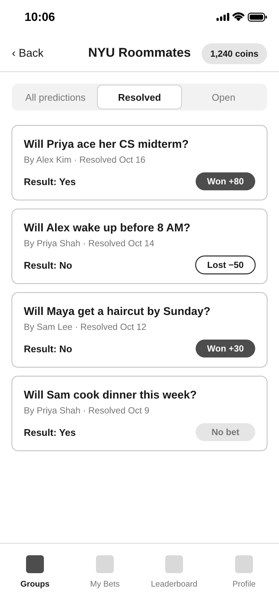
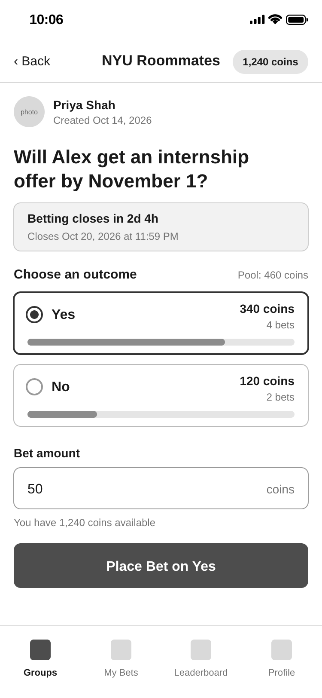
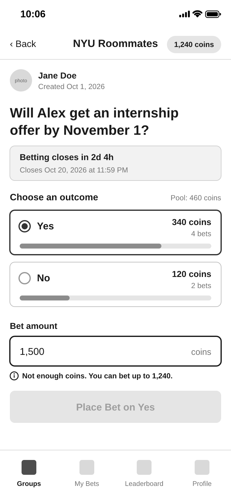
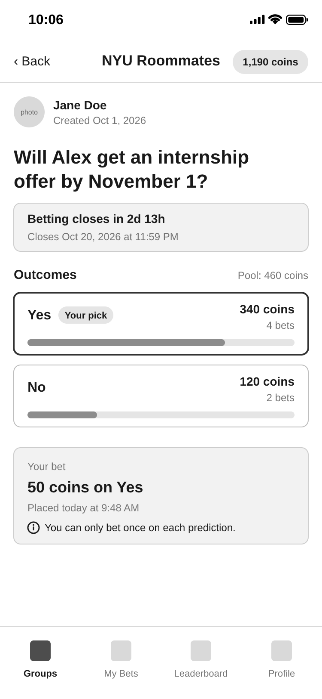
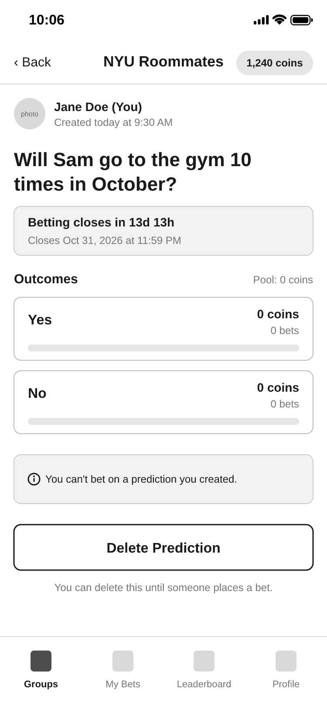
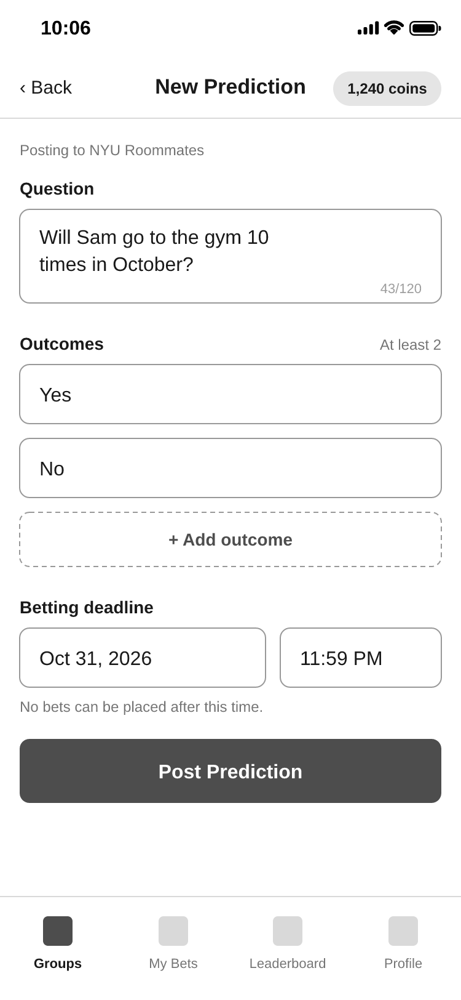
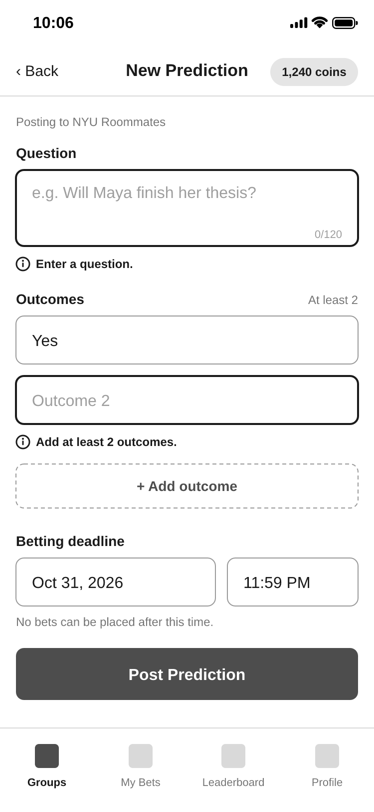
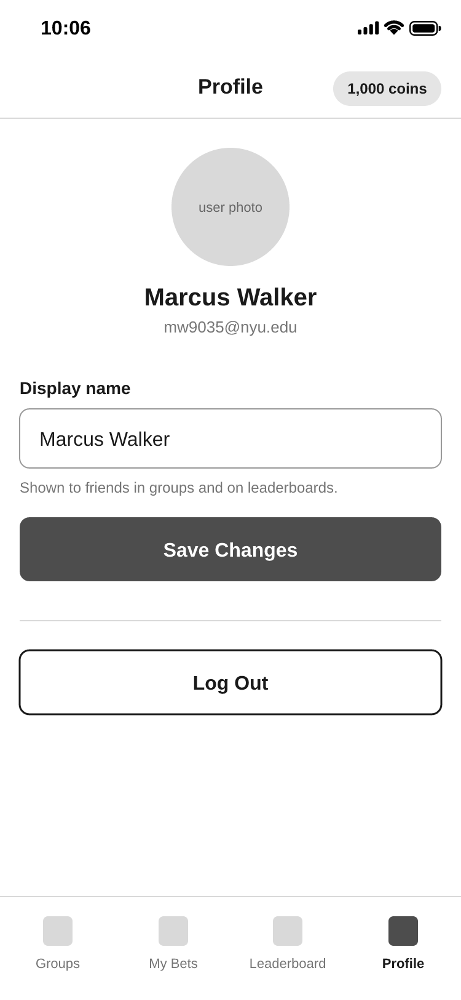

# Bet on Your Friends UX Design

**Bet on Your Friends** is a web app where friends make predictions about each other's lives and bet virtual coins on the outcomes.

## Wireframes

[Here](https://www.figma.com/design/swvxz89hm5fBcoFZp1cMPC/bet-on-your-friends?node-id=6-283&t=JWvmNmBGUGidtrnL-1) is the link to our wireframes.

## Prototype

[Here]() is the link to our clickable prototype.

## App Map

[Here]() is the link to our clickable app map.

## Work Split

- **Alisha (az2924):** My Groups, Group: Resolved Predictions, Prediction Detail (Bettor View, Not Enough Coins, Already Bet, Creator View), Create Prediction (and Errors), Profile, and the app map for these screens
- **Sufyan:** 
- **Vihaan:** 
- **Nihal:** 

## App Map

## Wireframes

On every signed-in screen, the pill in the header shows the user's current coin balance, and the bottom bar switches between Groups, My Bets, Leaderboard, and Profile.

---

### Groups

#### My Groups

Lists the user's groups after they log in. The welcome banner only appears on a new user's first visit, showing their 1,000 starting coins.

#### Group: Resolved Predictions

Shows a group's finished predictions and their results. The badge shows whether the user won coins, lost coins, or didn't bet.

---

### Predictions

#### Prediction Detail: Bettor View

Lets a group member pick an outcome and place a bet. Each outcome shows how many coins have been bet on it.

#### Prediction Detail: Not Enough Coins

Shown when the user enters more coins than they have. Place Bet stays disabled until the amount is valid.

#### Prediction Detail: Already Bet

Shown after the user has bet. Users can only bet once per prediction, so the bet form is replaced with their bet.

#### Prediction Detail: Creator View

Creators can't bet on their own predictions. Delete Prediction only appears until someone places a bet.

#### Create Prediction

Form for posting a new prediction with a question, at least two outcomes, and a betting deadline. Bets close at the deadline.

#### Create Prediction: Errors

Shown when Post Prediction is tapped without a question or at least two outcomes.

---

### Account

#### Profile

Lets the user change the display name friends see in groups and on the leaderboard, or log out.

