# Bet on Your Friends UX Design

**Bet on Your Friends** is a web app where friends make predictions about each other's lives and bet virtual coins on the outcomes.

## Wireframes

[Here](https://www.figma.com/design/swvxz89hm5fBcoFZp1cMPC/bet-on-your-friends?node-id=6-283&t=JWvmNmBGUGidtrnL-1) is the link to our wireframes.

Editable SVG files and PNG exports for the added screens are in [ux-design](ux-design/).

## Prototype

[Clickable prototype](https://www.figma.com/proto/swvxz89hm5fBcoFZp1cMPC/bet-on-your-friends?node-id=65-2&scaling=min-zoom&content-scaling=fixed&page-id=0%3A1&starting-point-node-id=65%3A2). Anyone with the link can view it. Flow 1 starts at Login; Flow 2 starts with a group invitation.

## App Map

[Link to page](https://www.figma.com/design/swvxz89hm5fBcoFZp1cMPC/bet-on-your-friends?node-id=77-3)

<a href="ux-design/prototype/app-map.png">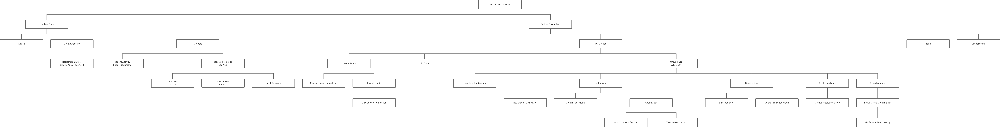</a>

## Work Split

- **Sufyan Waryah** ([sufyanw](https://github.com/sufyanw)): Created wireframes for Landing Page, Create Account with email, age, and password-mismatch errors, Create Group with missing-name,  Invite Friends with the copied-link notification, My Bets with prediction statuses, input the outcome (Yes/No), which includes abort + confirmation. 
- **Alisha Zaman** ([az2924](https://github.com/az2924)): Created wireframes for My Groups, Group: Resolved Predictions, Prediction Detail (Bettor View, Not Enough Coins, Already Bet, Creator View), Create Prediction (and Errors), and Profile; Created the app map for those screens; Created the initial template in `UX-DESIGN.md` for everyone to utilize
- **Vihaan Agarwal** ([VihaanAgarwal](https://github.com/VihaanAgarwal)): Created wireframes for Login, Join Group, Open and All Predictions, Group Members, Leave Group confirmation, My Groups after leaving, Edit Prediction, and Final Outcome. Connected prototype flows for stories #15–26 using the existing team screens.
- **Nihal Sundari** ([NISUN05](https://github.com/NISUN05)): Created wireframes for Leaderboard; Activity (Bets View, Predictions View); and Prediction Post-Bet Interactions (Confirm Bet Modal, Delete Confirmation Modal, Comment Draft & Posted Thread, Bettor Breakdown for Yes/No Bettors); Created the app map for those screens.

---
### Getting Started with Bet On Your Friends

#### Landing Page

Introduces Bet on Your Friends and directs visitors to Create Account or Log In.

<a href="ux-design/Landing-Page.png">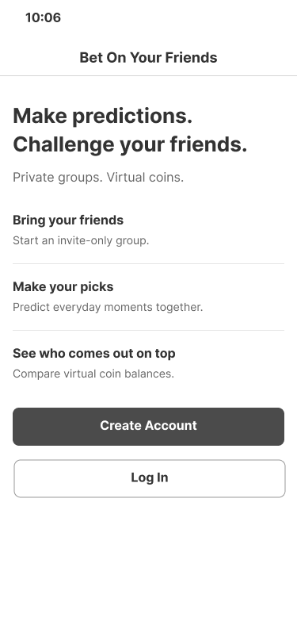</a>

---

### Account

#### Create Account

Collects a name, email address, date of birth, password, and password confirmation. Create Account continues to My Groups after successful registration; the Log in link opens the existing login screen.

<a href="ux-design/Create-Account.png">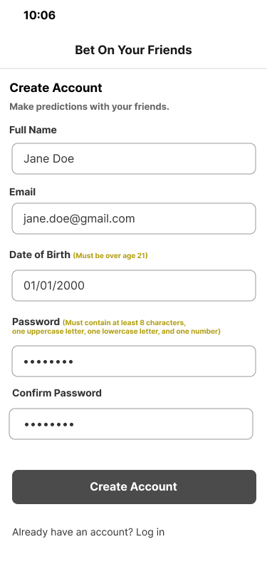</a>

#### Create Account: Email Already Registered

Shows an error when the email address is already associated with an account. The user can use a different email address or follow Log in to access their existing account.

<a href="ux-design/Create-Account-Email-Error.png">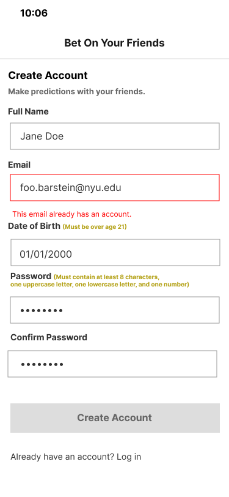</a>

#### Create Account: Age Requirement

Shows date-of-birth validation when the entered date does not meet the app's minimum age of 21. Create Account remains disabled while the form is invalid.

<a href="ux-design/Create-Account-Age-Error.png">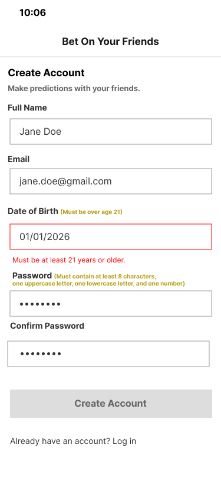</a>

#### Create Account: Password Mismatch

Highlights Confirm Password when it does not match Password. Create Account remains disabled until the two values match and the form is valid.

<a href="ux-design/Create-Account-Password-Mismatch.png">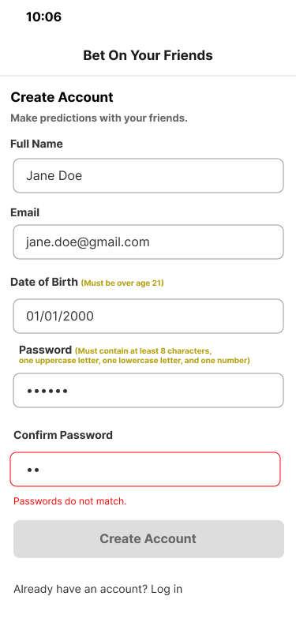</a>

---
### Groups

#### Create Group

Lets a user name a private group, add a description, and choose whether all members or only admins may invite friends. Public is marked TBD and is unavailable (not within the scope of our project but it can be something worth exploring if we choose to work on this project post this semester). Create group proceeds to Invite Friends; Back returns to My Groups.

<a href="ux-design/Create-Group.png">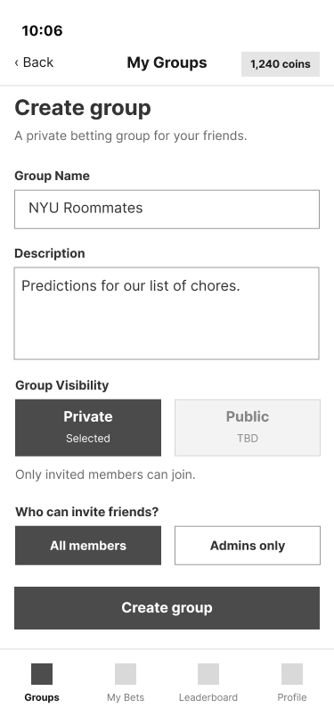</a>

#### Create Group: Missing Name

Highlights the required Group Name field when it is empty -> indicates that you need to put in a group name; create group is disabled until a valid group name is provided.

<a href="ux-design/Create-Group-Error-no-group-name.png">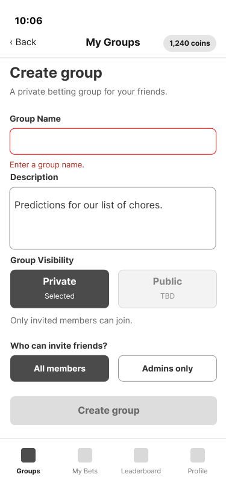</a>

#### Invite Friends

Displays the newly created group's invitation link. Copy triggers the copied-link notification. Pressing the go to group button opens the group's predictions.

<a href="ux-design/Invite-Friends.png">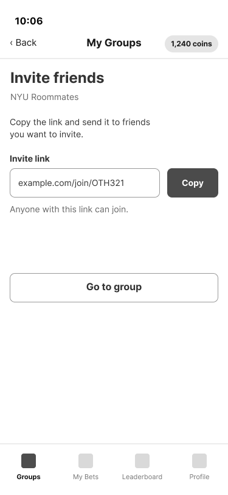</a>

#### Invite Friends: Link Copied

Shows the link copied to clipboard notification after the copy button is pressed.

<a href="ux-design/Invite-Friends-link-copied-2-clipboard.png">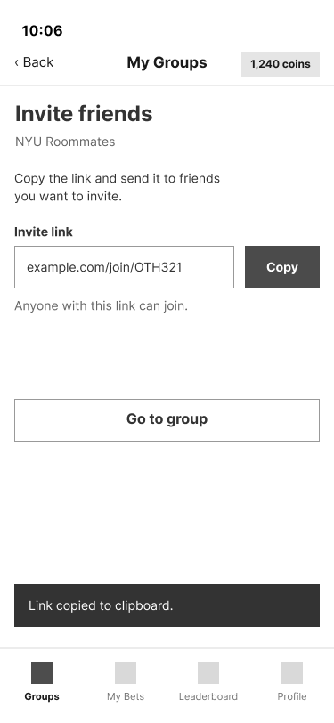</a>

#### My Groups

Lists the user's groups after they log in.

<a href="ux-design/Open-On-Groups-For-Returning-User.png">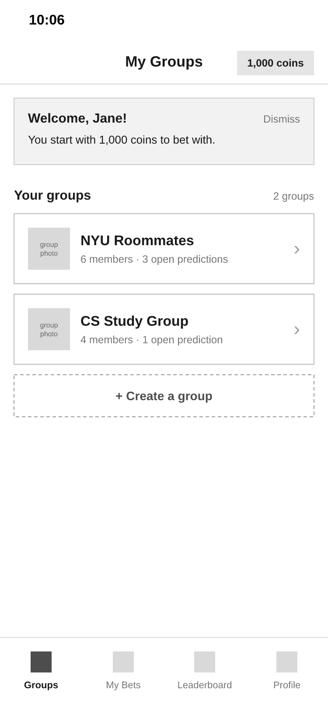</a>

#### Join Group

Shows an invitation. Join Group adds the group to My Groups; Decline returns without joining.

<a href="ux-design/join-group.png">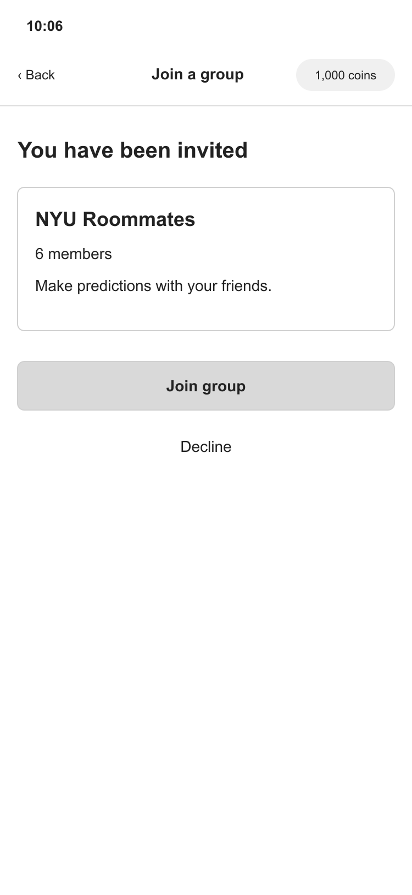</a>

#### Group: All Predictions

Lists open and resolved predictions. The tabs filter the list; the member count opens Group Members.

<a href="ux-design/group-all-predictions.png">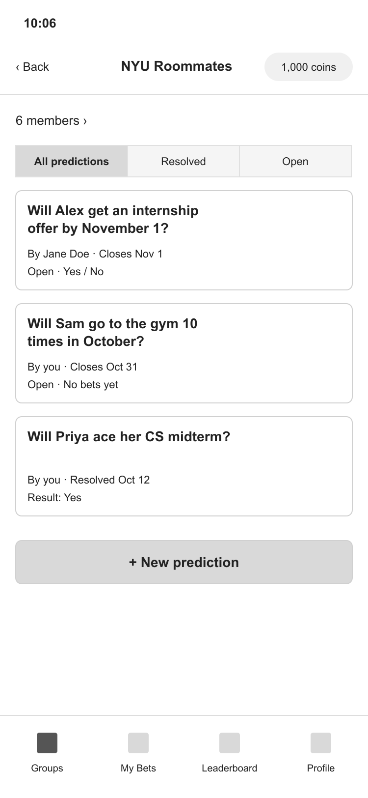</a>

#### Group: Open Predictions

Lists predictions that are still open for bets. Tapping a prediction opens its details.

<a href="ux-design/group-open-predictions.png">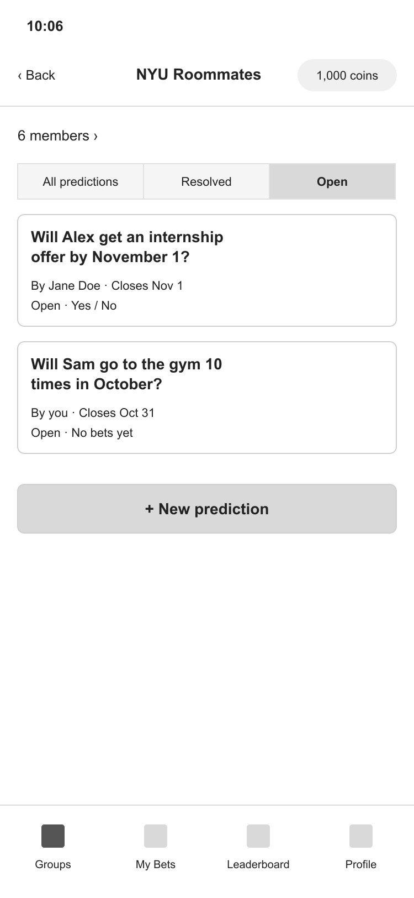</a>

#### Group: Resolved Predictions

Shows a group's finished predictions and their results. The badge shows whether the user won coins, lost coins, or didn't bet.

#### Group Members

Lists the group's members and provides the Leave Group action.

<a href="ux-design/group-members.png">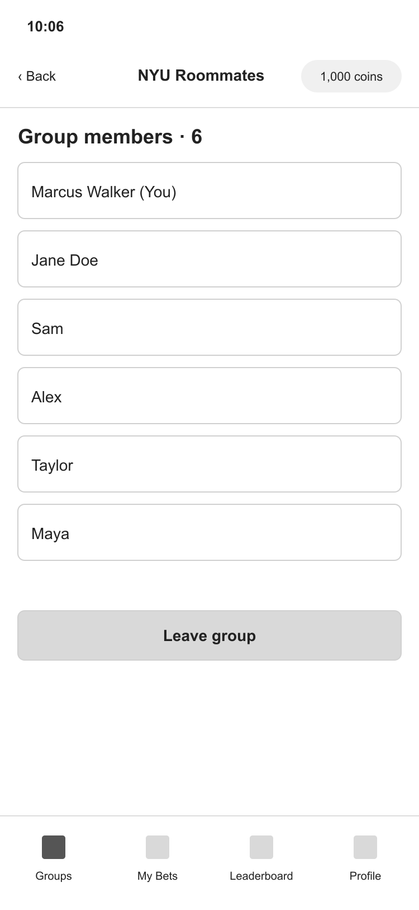</a>

#### Leave Group Confirmation

Cancel returns to Group Members. Leave Group removes the group from My Groups.

<a href="ux-design/leave-group-confirmation.png">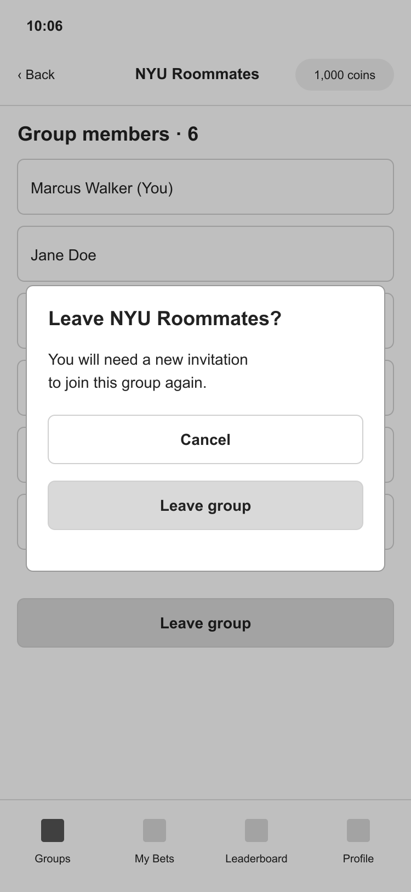</a>

#### My Groups: After Leaving

Shows the remaining groups after leaving NYU Roommates. A new invitation allows the user to rejoin.

<a href="ux-design/my-groups-after-leaving.png">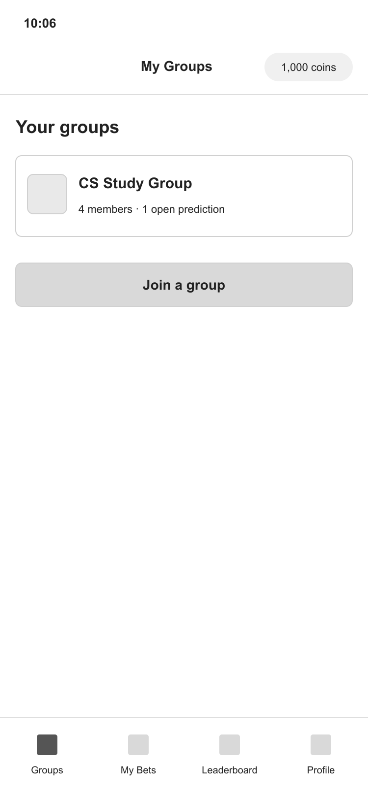</a>

---
#### My Bets

Lists predictions the user has joined or created, shows if the prediction is either open closed or resolved. If the set outcome button is present, then you, the creator, can navigate through the steps and resolve the bet for the whole group. More details below...

<a href="ux-design/My-Bets.png">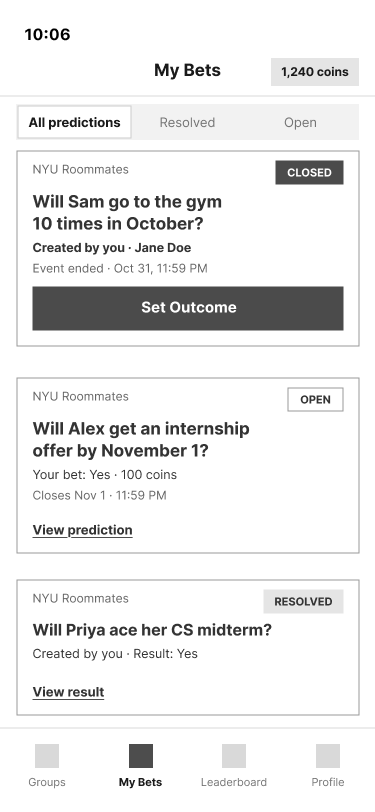</a>
---
### Predictions

#### Prediction Detail: Bettor View

Lets a group member pick an outcome and place a bet. Each outcome shows how many coins have been bet on it.

<a href="ux-design/Placed-Prediction.png">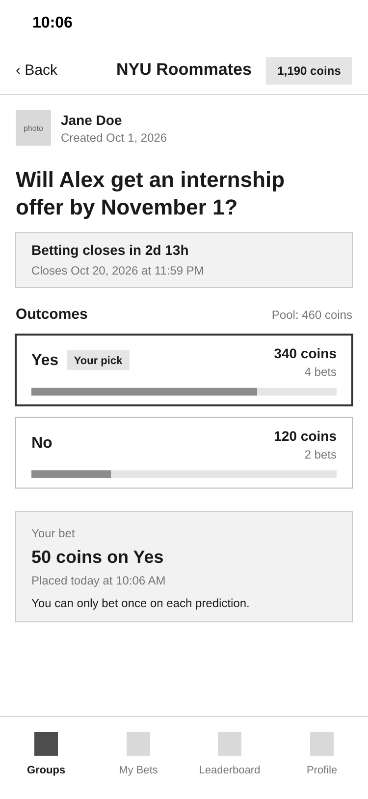</a>

#### Prediction Detail: Not Enough Coins

Shown when the user enters more coins than they have. Place Bet stays disabled until the amount is valid.

<a href="ux-design/Cannot-Bet-More-Than-Your-Available-Coins.png">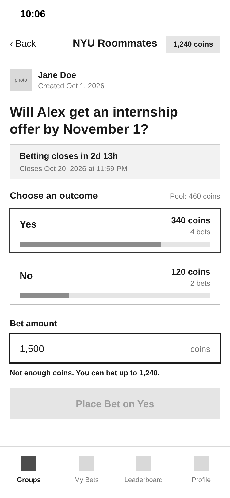</a>

#### Prediction Detail: Already Bet

Shown after the user has bet. Users can only bet once per prediction, so the bet form is replaced with their bet.

#### Prediction Detail: Creator View

Creators can't bet on their own predictions. Edit and Delete Prediction only appear until someone places a bet.

<a href="ux-design/Cannot-Bet-On-Your-Prediction.png">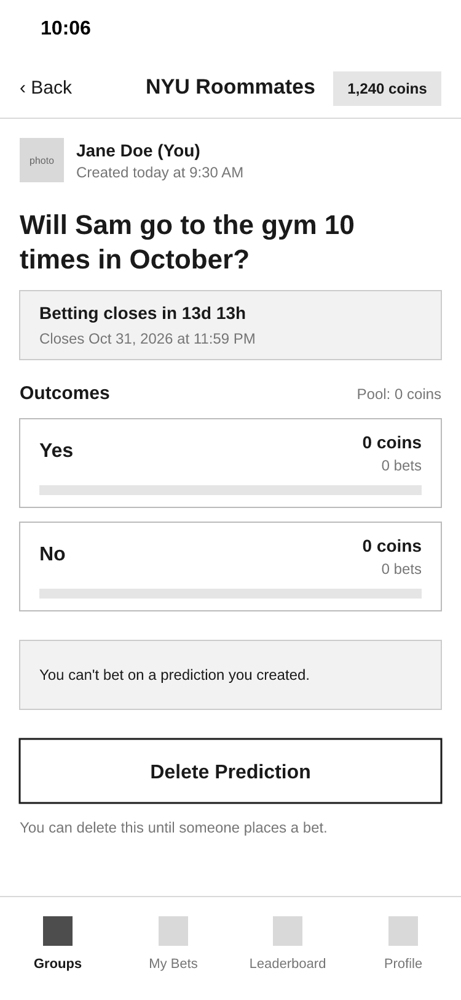</a>

#### Create Prediction

Form for posting a new prediction with a question, at least two outcomes, and a betting deadline. Bets close at the deadline.

#### Create Prediction: Errors

Shown when Post Prediction is tapped without a question or at least two outcomes.

<a href="ux-design/Cannot-Bet-After-Prediction-Deadline.png">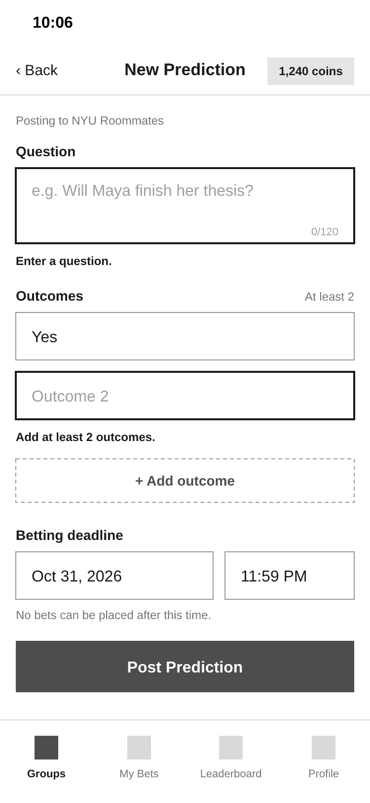</a>

#### Edit Prediction

Lets the creator edit the question, outcomes, and deadline before anyone bets. Save Changes returns to the prediction; Cancel discards edits.

<a href="ux-design/edit-prediction.png">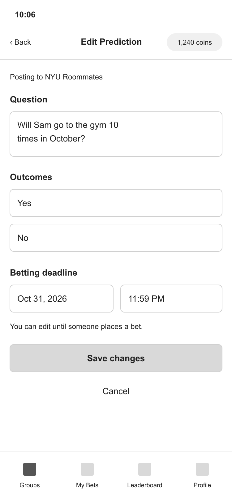</a>

#### Resolve Prediction: Yes Selected

Lets the prediction creator select Yes as the winning outcome after the event has ended. Confirm Result opens the Yes confirmation dialog; it does not save the outcome yet. Selecting No switches to the No-selected state. Cancel or Back returns to My Bets.

<a href="ux-design/Resolve-Prediction-outcome-yes.png">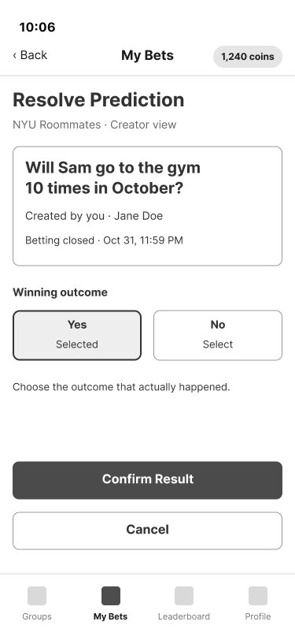</a>

#### Confirm Resolution: Yes

Displays a confirmation dialog over the Yes-selected screen. Confirm result records Yes and proceeds to the final-outcome view on success. Cancel dismisses the dialog and preserves the Yes selection. Background controls are inactive while the dialog is open.

<a href="ux-design/Confirm-Resolve-Prediction-outcome-yes.png">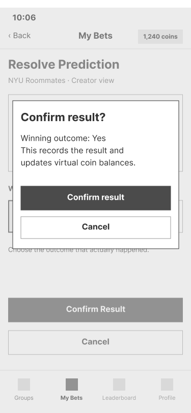</a>

#### Resolve Prediction: Yes -> Save Failed

Shows that no result was saved while preserving the Yes selection. Confirm Result allows the creator to review the confirmation another time and retry. Cancel returns to My Bets without recording an outcome.

<a href="ux-design/Resolve-Prediction-outcome-yes-failed-to-save.png">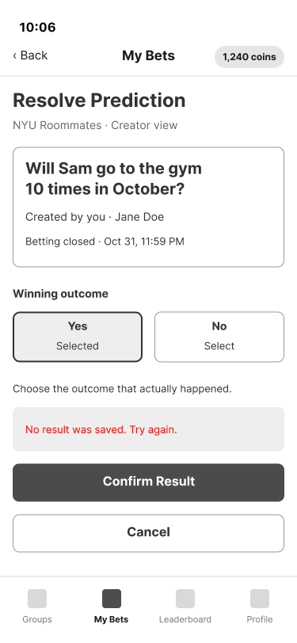</a>

#### Resolve Prediction: No Selected

Lets the prediction creator select No as the winning outcome after the event has ended. Confirm Result opens the No confirmation dialog; it does not save the outcome yet. Selecting Yes switches to the Yes-selected state. Cancel or Back returns to My Bets.

<a href="ux-design/Resolve-Prediction-outcome-no.png">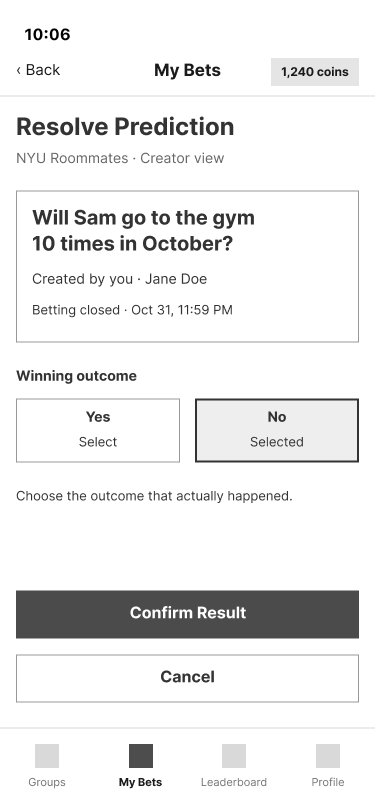</a>

#### Confirm Resolution: No

Displays a confirmation dialog over the No-selected screen. Confirm result records No and proceeds to the final-outcome view on success. Cancel dismisses the dialog and preserves the No selection. Background controls are inactive while the dialog is open.

<a href="ux-design/Confirm-Resolve-Prediction-outcome-no.png">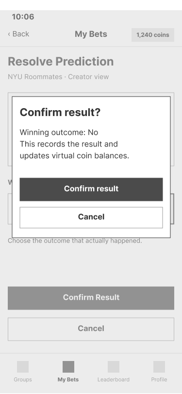</a>

#### Resolve Prediction: No Save Failed

Shows that no result was saved while preserving the No selection. Confirm Result allows the creator to review the confirmation and retry. Cancel returns to My Bets without recording an outcome.

<a href="ux-design/Resolve-Prediction-outcome-no-failed-to-save.png">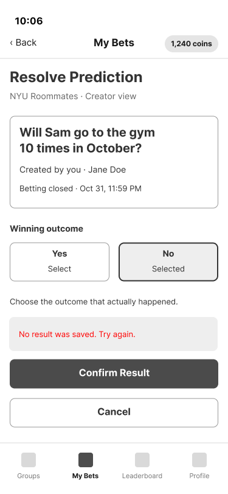</a>

#### Prediction: Final Outcome

Shows the creator the final outcome of a resolved prediction. Resolved predictions cannot be edited.

<a href="ux-design/prediction-final-outcome.png">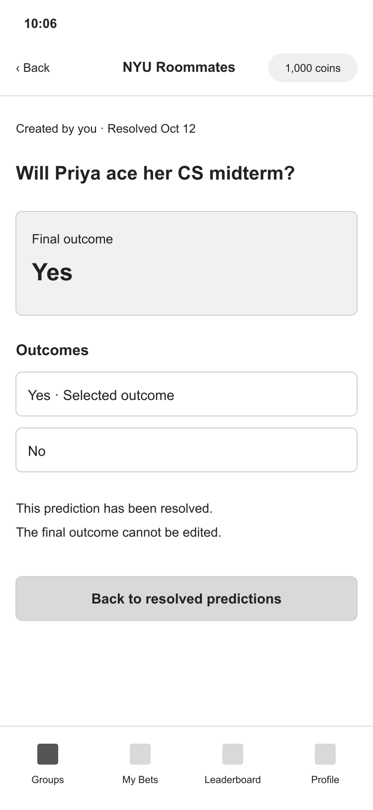</a>

#### Prediction Action: Bet Confirmation Modal

Shows a confirmation modal when a user attempts to place a bet, summarizing the selection and warning that wagers cannot be undone.

<a href="ux-design/bet-confirmation-modal.png">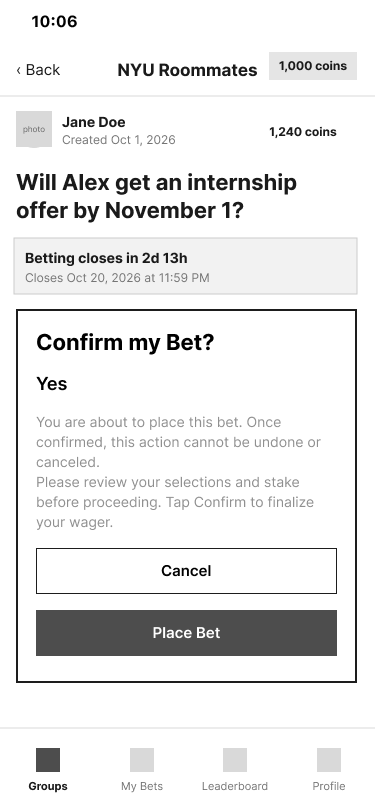</a>

#### Prediction Action: Prediction Deletion Confirmation Modal

Shows a warning confirmation modal when a creator attempts to permanently delete an unbet-on prediction.

<a href="ux-design/prediction-deletion-confirmation-modal.png">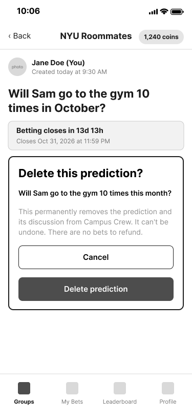</a>

#### Prediction Action: Draft Comment 

Provides a text draft box with character limits for adding the first comment to a prediction before posting.

<a href="ux-design/draft-comment.png">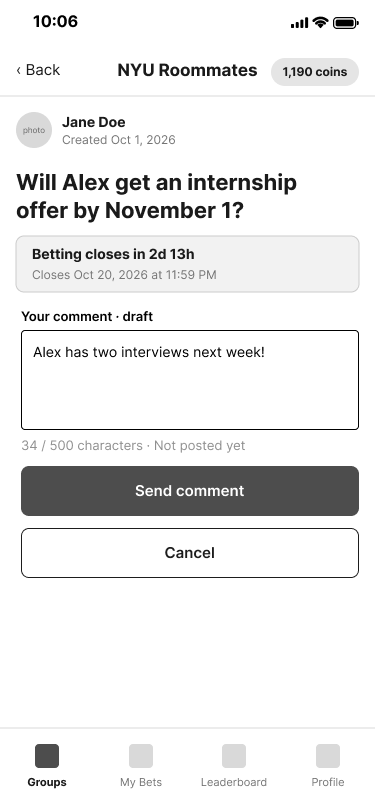</a>

#### Prediction Action: Draft First Comment

Provides a text draft box with character limits for adding the first comment to a prediction before posting.

<a href="ux-design/draft-first-comment.png">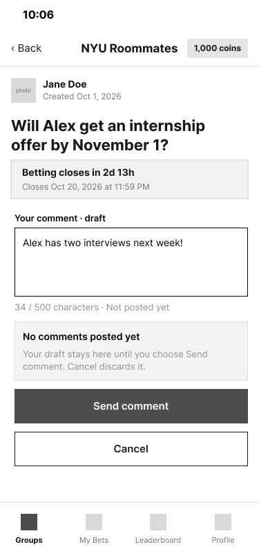</a>

#### Prediction Action: Comments Thread

Displays posted comments from group members under a prediction, along with an inline input box to add further comments.

<a href="ux-design/comments-thread.png">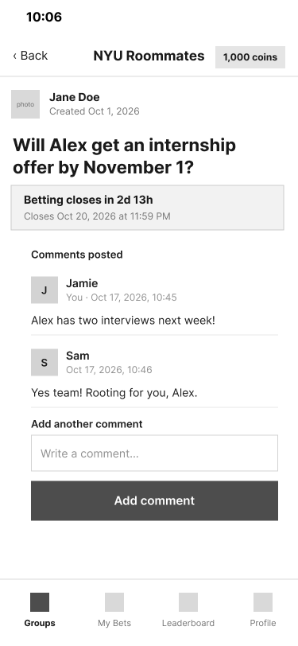</a>

#### Prediction Audit: Bettor Breakdown (Yes Bettors)

Lists all group members who placed a bet on "Yes," showing individual coin stakes and timestamp details.

<a href="ux-design/Yes-Bettors-List.png">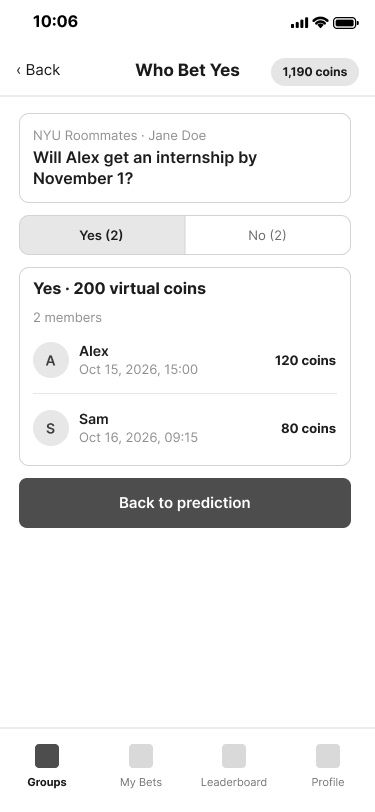</a>

#### Prediction Audit: Bettor Breakdown (No Bettors)

Lists all group members who placed a bet on "No," showing individual coin stakes and timestamp details.

<a href="ux-design/No-Betters-List.png">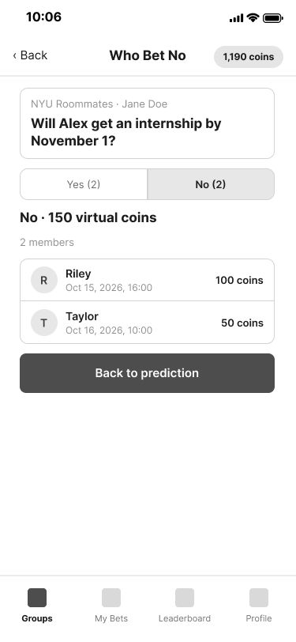</a>

---

### Account

#### Login

Lets a returning user log in and open My Groups.

<a href="ux-design/login.png">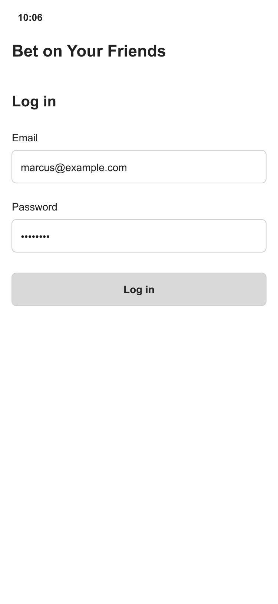</a>

#### Profile

Lets the user change the display name friends see in groups and on the leaderboard, or log out.

<a href="ux-design/Change-Profile-Display-Name.png">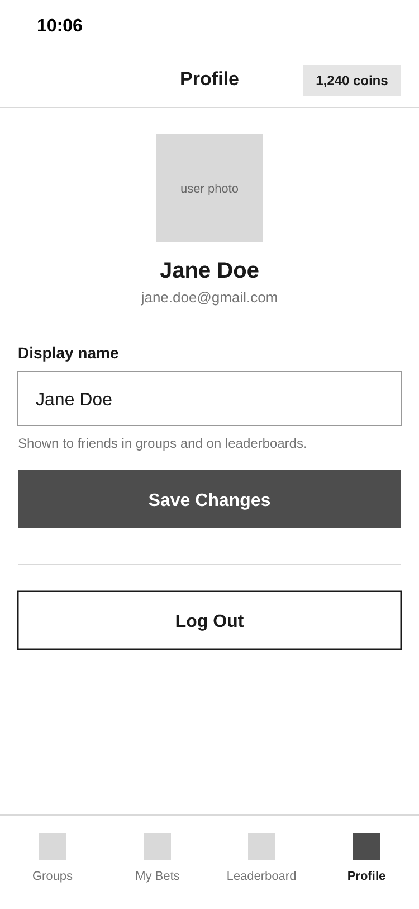</a>

---

### Leaderboard

#### Leaderboard

Ranks group members by their available virtual coin balances from highest to lowest.

<a href="ux-design/Leaderboard.png">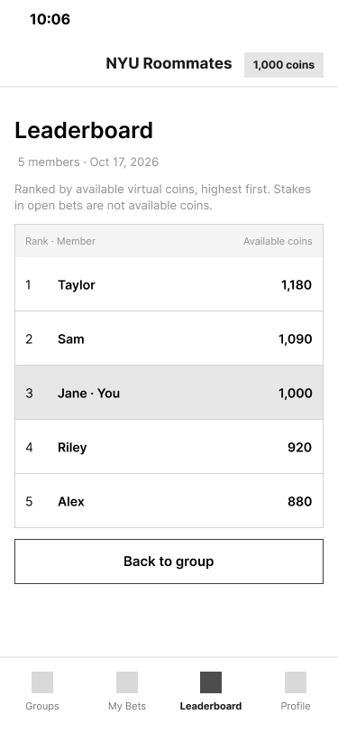</a>

---

### Activity 

#### Recent Activity: Bets

Displays a log of the user's placed bets and settled bet results across predictions.

<a href="ux-design/recent-activity-bets-view.png">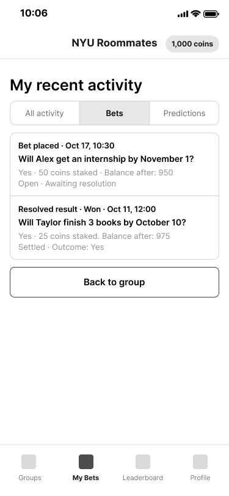</a>

#### Recent Activity: Predictions

Displays a log of predictions created by the user along with their current status and resolution timelines.

<a href="ux-design/recent-activity-predictions-view.png">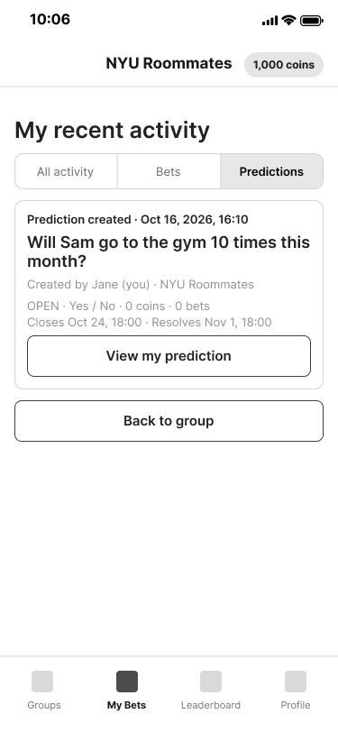</a>
